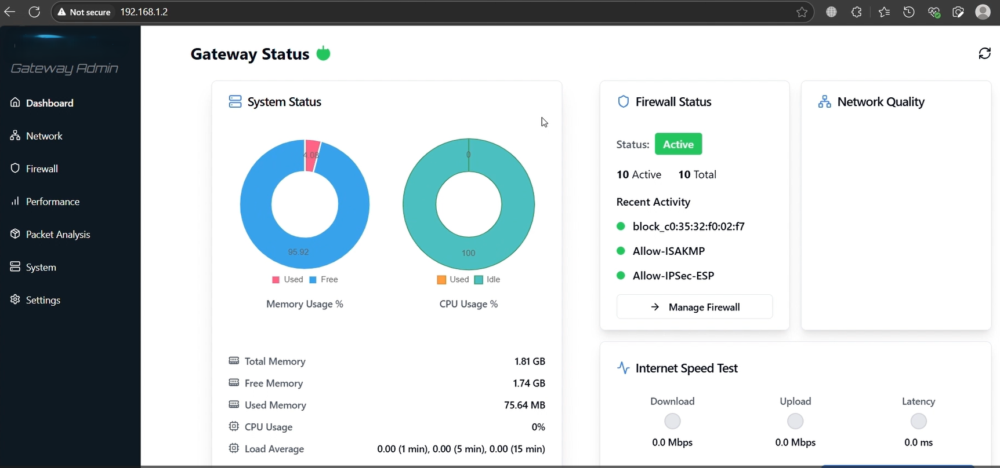
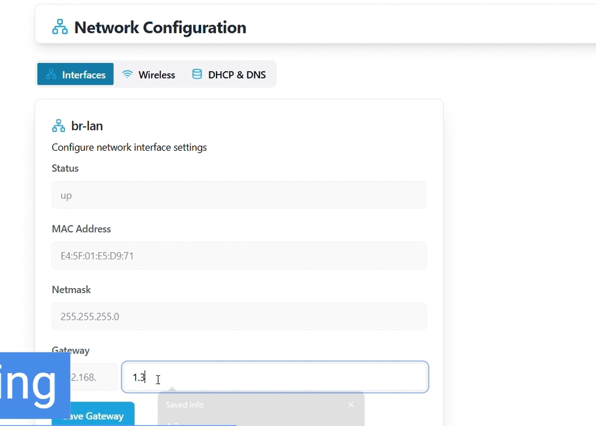
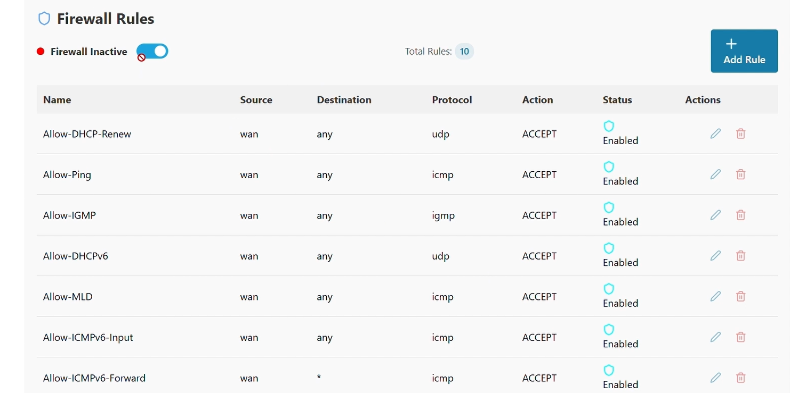
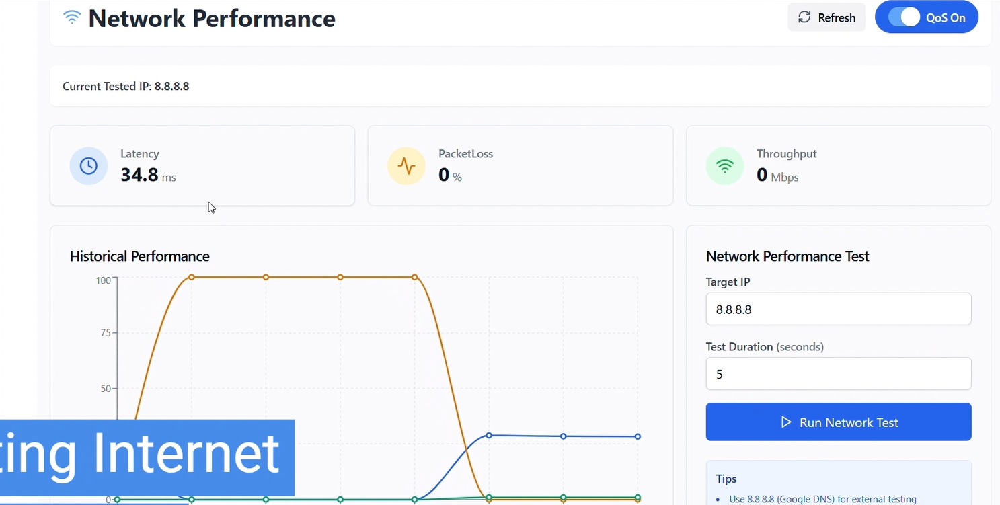
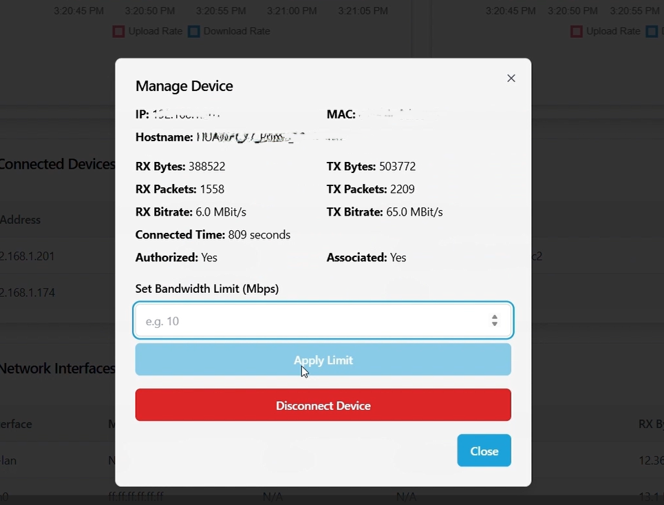

# Embedded Gateway Dashboard 🌐

A modern dashboard for monitoring and managing embedded gateways and edge devices.

This project combines a polished frontend with lightweight backend utilities for gateway environments such as OpenWrt- or prplOS-based systems. The goal is simple: make device management, network visibility, and system monitoring feel clear, practical, and approachable.

## ✨ What this project is about

The dashboard is built to help you:

- view gateway and device status at a glance
- inspect connected devices and network activity
- run network and performance checks
- explore logs, alerts, and system health
- interact with common gateway features through a cleaner UI

It started as a frontend-heavy project and now also includes backend CGI endpoints plus native daemons for cached monitoring tasks.

## 🖼️ Preview

Main dashboard view:



| Network configuration | Firewall rules |
| --- | --- |
|  |  |
| **Performance** | **Connected device management** |
|  |  |

More screenshots are in [`docs/screenshots/`](./docs/screenshots/).

## 🚀 Highlights

- `Frontend SPA` built with Vite, TypeScript, and Tailwind CSS
- `Backend CGI layer` for gateway-side actions and data exchange
- `Performance daemon` for cached network performance monitoring
- `Packet analyzer daemon` for lightweight packet capture summaries
- `Gateway-focused design` for embedded and edge-device use cases

## 🧩 What’s inside

### Frontend

The frontend lives in `src/` and provides the main user experience:

- dashboard overview
- connected devices
- network tools
- packet analysis
- performance monitoring
- firewall and settings pages
- system and security views

### Backend

The `backend/` folder contains the gateway-side pieces:

- `rpcd/` — rpcd plugin (`gateway` ubus object) and the ACL used by the dashboard
- `cgi-scripts/` — legacy CGI endpoints, being migrated to ubus
- `daemons/` — native C daemons for background monitoring
- `init.d/` — procd init scripts for service startup
- `Makefile` — builds the daemons natively or with a cross-compiler

In short:

- `performance` handles cached latency, packet loss, and throughput metrics
- `packet-analyzerd` handles packet capture summaries for the packet analysis page

## 🛠️ Running the frontend locally

From the project root:

```bash
npm install
npm run dev
```

The dev server proxies `/ubus` and `/cgi-bin` to the gateway at `http://192.168.1.2`.
Point it at another device with:

```bash
GATEWAY_URL=http://192.168.1.1 npm run dev
```

To build the frontend:

```bash
npm run build
```

## 🔐 Authentication and the ubus API

The dashboard talks to the gateway through OpenWrt's native **ubus** bus, exposed over
HTTP as JSON-RPC by `uhttpd` (`/ubus`) and `rpcd`:

```
Browser ──JSON-RPC──▶ uhttpd /ubus ──▶ rpcd ──▶ ubus objects
                                         │        ├─ system  (built in: board, info, reboot)
                                         │        └─ gateway (rpcd/plugins/gateway)
                                         └─ session + ACL check on every call
```

- **Login** opens an rpcd session (`session.login`). The browser only keeps the session id,
  never the password. Users are the gateway's system users (by default `root`).
- **Every call is authorised on the gateway** against the session and the ACL in
  `rpcd/acl.d/gateway-dashboard.json`. Expired sessions send the user back to the login page.
- **No shell process per request** for built-in objects such as `system board` and `system info`.

### Install on the gateway

Requires `rpcd` and `uhttpd-mod-ubus` (installed by default with LuCI).

```bash
cd backend
make install DESTDIR=/path/to/rootfs     # or copy the files listed in the Makefile
/etc/init.d/rpcd reload                  # on the gateway, to load the plugin and ACL
```

### Migration status

| Feature | Backend |
| --- | --- |
| Login, logout, session expiry | ubus (`session`) |
| System information | ubus (`system`, `gateway.cpu_info`) |
| Reboot | ubus (`system.reboot`) |
| Password change | ubus (`gateway.set_password`) |
| Dashboard, network, wireless, DHCP/DNS, firewall, devices, alerts, performance, packet analysis, speed test | CGI (to be migrated) |

## ⚙️ About the backend

The backend is designed for gateway-style Linux targets rather than a typical cloud server.

That means:

- CGI scripts are meant to run on the device web root
- daemons are meant to run on the target system as background services
- compiled binaries must match the target architecture

So if you build on:

- `x86_64` → you get an x86_64 binary
- `ARM / Raspberry Pi` → you need an ARM-compatible toolchain

The backend `Makefile` is flexible enough to support native builds and cross-compilation without locking the project to one target.

## 🎯 Current focus

This repository is strongest today in:

- frontend experience and page coverage
- embedded dashboard concepts and flows
- practical backend integration for gateway monitoring

It is a good foundation for:

- gateway demos
- student or research projects
- OpenWrt / prplOS experiments
- custom device management interfaces

## 🤝 Contributing

Contributions are welcome.

If you want to improve the UI, extend backend coverage, or package the project more cleanly for embedded targets, feel free to open an issue or a pull request.

## 👤 Author

By Yassin Omri

